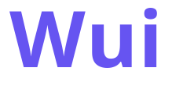

<div align="center">



<hr>

**Wave로 만든 Wave용 작은 선언형 GUI 라이브러리.**

창을 "상태를 받아 화면을 만드는 함수"로 기술하면, Wui가 배치하고 그려서 보여 줍니다.

[안내서](docs/GUIDE.ko.md) · [API](docs/API.md) · [예제](examples) · [빌드](docs/BUILDING.ko.md) · [변경 내역](CHANGELOG.md)

[](https://github.com/potatosl/Wui/actions/workflows/ci.yml) [](LICENSE) [](https://wave-lang.dev)

[English](README.md) | **한국어**

</div>

이벤트가 올 때마다 Wui가 여러분의 코드가 만든 트리를 받아서 배치하고, 자체 소프트웨어 렌더러로 그려서 보여 줍니다. GPU 코드도, 밑에 깔린 위젯 툴킷도 없고, Wave 컴파일러
말고는 설치할 것이 없습니다(Linux에서는 libX11 라이브러리도 필요합니다).

## 맛보기

```wave
struct Model {
    count: i32;
}

fun update(m: ptr<Model>, msg: i32) {
    if (msg == MSG_INC) { m.count += 1; }
    if (msg == MSG_RESET) { m.count = 0; }
}

fun view(ui: ptr<Ui>, m: ptr<Model>, w: i32, h: i32) {
    ui_clear(ui);
    var card: i32 = ui_column(ui, UI_ROOT, 16, 10);      // 부모, 여백, 간격
    ui_text(ui, card, "Hello from Wui");
    var row: i32 = ui_row(ui, card, 0, 8);
    ui_button(ui, row, "+1", MSG_INC);                   // 클릭하면 MSG_INC가 돌아옴
    ui_button(ui, row, "Reset", MSG_RESET);
    ui_layout(ui, w, h);
}
```

버튼은 콜백 대신 메시지 번호를 가집니다. 이벤트 루프가 클릭과 키를 Wui에 넘기고, 돌아온 메시지를
`update`에서 처리한 뒤 `view`를 다시 부릅니다. 프레임을 넘어 살아남아야 하는 상태(입력창에 친 글자, 스크롤
위치, 포커스)는 여러분이 준 id로 Wui 안에 보관됩니다. 이벤트 루프까지 포함한 카운터 프로그램 전체는
[`examples/counter.wave`](examples/counter.wave)입니다.

## 들어 있는 것

- **레이아웃**: 여백, 간격, 늘어나기, 정렬이 있는 행과 열. 작은 flexbox와 비슷합니다.
- **위젯**: 글자, 버튼, 체크박스, 라디오 버튼, 탭, 슬라이더, 진행 막대, 드롭다운, 한 줄 / 여러 줄 입력창,
  스크롤 상자, 메뉴, 툴팁, 트리, 테이블, 대화상자, 파일 목록.
- **글자**: 시스템에 있는 TrueType / OpenType 폰트, 선택, 클립보드, 입력기(X11에서 한글 등 조합 글자).
- **모양**: 밝은 / 어두운 테마, `"#1E3A8A"` 같은 글자로 쓰는 색, JSON 파일 테마, 글자 크기와 화면 배율.
- **키보드**: Tab 순서, Enter와 Space, 포커스 링.
- **헤드리스**: 창 없이 트리를 배치하고 자기 버퍼에 그릴 수 있습니다.

Windows와 macOS의 창 코드만 빼고 전부 Wave입니다. 그 부분은 Wave가 아직 못 하는 함수 주소가 필요해서 작은 Rust
크레이트(`winplat/`)로 되어 있고, 그 두 플랫폼에서는 디렉터리 목록도 이 크레이트가 맡습니다.

## 지원 플랫폼

| | 상태 |
|---|---|
| Linux (X11) | 동작함. Wui를 개발하고 시험하는 곳입니다 |
| Windows (x64, ARM64) | CI에서 빌드, 링크, 단위 테스트가 통과합니다. 실제 기기에서 창을 띄워 본 적은 아직 없습니다 |
| macOS (Intel, Apple silicon) | 위와 같음 |
| FreeBSD (X11) | Linux와 같은 코드, 미확인 |

Windows나 macOS에서 써 보셨다면 결과를 알려 주세요.

## 시작하기

[Wave 컴파일러](https://github.com/wavefnd/Wave)(`wavec`)가 필요합니다. Linux, FreeBSD, macOS에서는 설치 스크립트가
Wui를 설치하고 링크 플래그를 아는 `wui-wavec` 래퍼를 만들어 줍니다(스크립트가 짧으니 먼저 읽어 보세요).

```
curl -fsSL https://raw.githubusercontent.com/potatosl/Wui/main/install.sh | sh
~/.wui/bin/wui-wavec run app.wave
```

`app.wave`에는 `import("wui")::{Ui, ui_new, ui_column, ui_button, win_open, ...};`처럼 씁니다.

예제를 보려면 저장소를 클론해서 하나 실행해 보세요.

```
git clone https://github.com/potatosl/Wui && cd Wui
WUI_RUN=counter wavec --std-root=$HOME/.wave/bin/std run build.wave
```

다른 예제: `widgets`, `form`, `menus`, `lists`, `files`, `theme`, `timer`, `scroll`. Windows, macOS, 직접 설정하는 법,
`vex`는 [빌드와 사용](docs/BUILDING.ko.md)에 있습니다.

## 더 알아보기

- [안내서](docs/GUIDE.ko.md): 모델, 이벤트 루프, 테마, 포커스, 스크롤, 오버레이, 예제.
- [API 레퍼런스](docs/API.md): 모든 함수 (영어).
- [구조](docs/ARCHITECTURE.ko.md): 소스가 어떻게 나뉘어 있는지.
- [빌드와 사용](docs/BUILDING.ko.md): 설치, 링크 플래그, 다른 플랫폼, 테스트.
- [버전 정책](docs/VERSIONING.md)과 [변경 내역](CHANGELOG.md).

## 현재 상태

Wui는 아직 어립니다. 1.0 이전에는 마이너 버전에서 API가 바뀔 수 있습니다. 입력창은 한 줄이고(여러 줄 입력은
순수 텍스트), 글자 줄바꿈은 없으며, 모든 것을 CPU로 그립니다. 버그 제보와 아이디어는 이슈로 환영합니다.
보안 문제는 [SECURITY.md](SECURITY.md)를 보세요.

## 라이선스

[MPL-2.0](LICENSE). JSON 테마에 쓰는 [wjson](https://github.com/potatosl/wjson)도 MPL-2.0입니다.

<p align="center">
  <a href="https://wave-lang.dev"></a>
</p>
